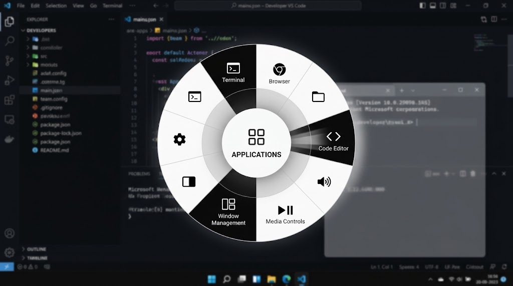

# ⭕ WinDial



WinDial is a Windows desktop utility for fast, gesture-driven actions. Instead of digging through menus, it opens a floating radial overlay that lets you launch apps, trigger shortcuts, manage windows, and run common tasks from a single position.

This repository is the active development workspace for the project. The current codebase is an early-stage Tauri + Angular + Rust application that establishes the desktop shell, overlay window, and the architecture described in the roadmap.

## Status

- Early alpha / active development
- Core desktop shell is in place
- Primary roadmap lives in [.ai/roadmap.md](./.ai/roadmap.md)
- The long-term product goal is a Windows-native action dial with context-aware wheel layouts

## Planned product direction

- Global hotkey to summon the overlay from anywhere
- Transparent frameless window positioned under the cursor
- Radial wheel with wedge/sector math and selection feedback
- Action execution for apps, URLs, snippets, hotkeys, and system actions
- Context-aware profiles for different foreground apps and workflows
- Window snapping, media shortcuts, and productivity actions for power users

## Tech stack

- **Desktop shell:** [Tauri v2](https://v2.tauri.app/)
- **Frontend UI:** [Angular](https://angular.dev/)
- **Backend logic:** [Rust](https://www.rust-lang.org/)
- **Target OS:** Windows

## Quick start

### Prerequisites

- Node.js 22 LTS
- Rust stable toolchain
- Visual Studio C++ build tools on Windows

### Install and run

```bash
npm install
npm run tauri dev
```

### Production build

```bash
npm run tauri build
```

## Project structure

- `src/` — Angular frontend and UI logic
- `src-tauri/` — Rust backend and Tauri configuration
- `docs/` — release notes and design RFCs
- `.ai/roadmap.md` — technical delivery plan for the product
- `scripts/release.mjs` — release automation helper

## Roadmap

WinDial follows a phased plan described in [.ai/roadmap.md](./.ai/roadmap.md):

- v0.1.x: foundation overlay + hotkey + wedge math
- v0.2.x: flick mechanics + visual feedback
- v0.3.x: configuration model + settings UI
- v0.4.x: context-aware loadouts
- v0.5.x: advanced system actions and window tools
- v1.0.0: production-ready desktop release

## Contributing

Contributions are welcome. Please read [CONTRIBUTING.md](./CONTRIBUTING.md) before opening a pull request.

## License

This project is licensed under the MIT License. See [LICENSE](./LICENSE) for details.